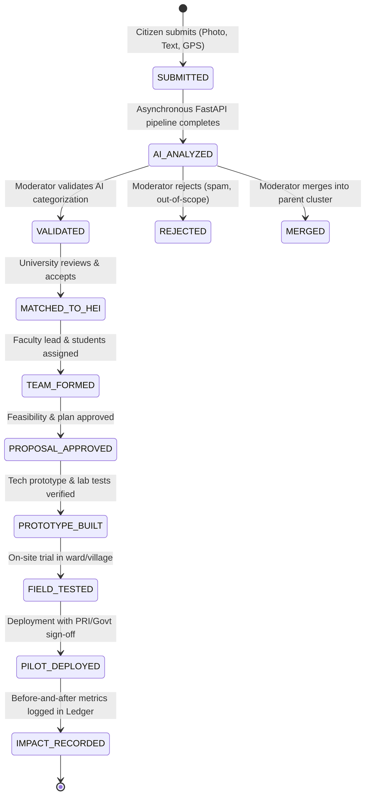

# CivicSolve — Reverse Engineering & Technical Mechanics (`REverse_engineering.md`)

This document presents a comprehensive reverse-engineering analysis of **CivicSolve**, deconstructing its architectural rationale, mathematical formulations, algorithmic pipelines, state machine mechanics, and inter-service API contracts.

---

## 1. Problem Statement Deconstruction & Comparative Gap Analysis

Existing Indian governance and innovation portals operate in segregated silos:
- **Grievance Redressal Portals (e.g., CPGRAMS)**: Treat civic problems as administrative complaints. Workflow ends when a department closes the ticket, with no mechanism for technological innovation or root-cause engineering.
- **Academic Repositories (e.g., YUKTI-NIR, AIM, Chancellor Portals)**: Operate from the **supply side** (academics propose hypothetical ideas and search for use cases), lacking direct connection to grassroot citizen demand.
- **Village Adoption Schemes (e.g., Unnat Bharat Abhiyan)**: Geographically restricted to pre-adopted villages without a real-time, demand-driven societal challenge exchange.

```
Existing World:
[Citizen Problem] ───> [Govt Department] ───> [Closed/Transferred (No Innovation)]
[University R&D]  ───> [Theoretical Project] ───> [Paper Published (No Field Impact)]

CivicSolve Paradigm:
[Citizen/PRI Problem]
         │ (Unstructured text + GPS + Photos)
         ▼
[AI Pipeline: Genome Extraction + Deduplication + Priority Scoring]
         │
         ▼
[Human Moderator Validation]
         │
         ▼
[Capability-Based Matching to University & Industry Solution Teams]
         │
         ▼
[Project Lifecycle: Proposal ➔ Prototype ➔ Field Test ➔ Pilot]
         │
         ▼
[Public Impact Ledger: Before-and-After Verified Community Metrics]
```

---

## 2. The "Challenge Genome": Data Structure Reverse Engineering

CivicSolve converts messy citizen reports into a structured canonical data object termed the **Challenge Genome**.

### 2.1 Transformation Pipeline
1. **Raw Input**: Multilingual text (English / Hindi), 1–5 geotagged photographs, GPS coordinates (latitude, longitude), and citizen-estimated impacted beneficiaries.
2. **Feature Extraction**:
   - Preprocessed text $\to$ 384-dimensional dense semantic vector via `sentence-transformers/all-MiniLM-L6-v2`.
   - Reverse geocoding $\to$ State, District, Tehsil, Ward/Gram Panchayat.
3. **Canonical Genome Schema**:
```json
{
  "challenge_id": "CS-2611",
  "taxonomy": {
    "domain": "Water Supply",
    "sub_domain": "Groundwater Quality",
    "confidence": 0.94,
    "keywords": ["handpump", "turbidity", "monsoon", "contamination", "fluoride"]
  },
  "geospatial": {
    "latitude": 22.9734,
    "longitude": 75.8321,
    "district": "Indore",
    "tehsil": "Sanwer",
    "ward": "Ward 4"
  },
  "priority_assessment": {
    "priority_score": 82.4,
    "severity_index": 0.90,
    "affected_population": 1200,
    "recurrence_factor": 0.80,
    "health_safety_risk": true,
    "explanation": "High priority due to repeat waterborne hazard near public primary school"
  },
  "duplicate_cluster": {
    "is_parent": true,
    "cluster_size": 14,
    "child_challenge_ids": ["CS-2615", "CS-2622", "CS-2680"]
  },
  "matched_entities": [
    {
      "institution_id": 101,
      "name": "Dept. of Civil & Environmental Engg., SGSITS Indore",
      "match_score": 0.94,
      "distance_km": 18.2,
      "rationale": "High expertise in rural water purification & water quality testing"
    }
  ]
}
```

---

## 3. Reverse Engineering the AI Algorithms

### 3.1 Pipeline A: Thematic Domain Classification
- **Input**: Challenge title + description text string $T$.
- **Vectorization**:
  $$\mathbf{e} = \text{SentenceTransformer}(T) \in \mathbb{R}^{384}$$
- **Classification**:
  Multi-class Logistic Regression with calibrated probability estimates:
  $$P(C_k | \mathbf{e}) = \frac{\exp(\mathbf{w}_k^T \mathbf{e} + b_k)}{\sum_j \exp(\mathbf{w}_j^T \mathbf{e} + b_j)}$$
- Primary domain $D^* = \arg\max_k P(C_k | \mathbf{e})$; Confidence score $= \max_k P(C_k | \mathbf{e})$.

### 3.2 Pipeline B: Semantic Duplicate Detection & Clustering
1. **Spatial Pruning**: Find all active challenges $C_j$ in database within a spatial radius:
   $$\text{ST\_DWithin}(\text{location}, \text{ST\_SetSRID}(\text{ST\_Point}(\text{lon}, \text{lat}), 4326), 15000)$$
2. **Cosine Similarity Evaluation**:
   $$\text{Sim}(\mathbf{e}_{\text{new}}, \mathbf{e}_j) = \frac{\mathbf{e}_{\text{new}} \cdot \mathbf{e}_j}{\|\mathbf{e}_{\text{new}}\| \|\mathbf{e}_j\|}$$
3. **Clustering Logic**:
   - If $\max_j \text{Sim} \ge 0.75$: Flag as potential duplicate candidate for Moderator console with candidate reference ID and similarity score.
   - Moderator one-click merge attaches new report as evidence under parent challenge and increments community report counter.

### 3.3 Pipeline C: Explainable Priority Scoring Model (0–100)
The Priority Score is calculated through a deterministic, explainable mathematical formulation:

$$\text{Priority} = \min\left(100, \, 100 \times \left(w_s \cdot S + w_p \cdot \min\left(1.0, \frac{\log_{10}(P + 1)}{4}\right) + w_r \cdot R + w_h \cdot H\right)\right)$$

Where:
- $S \in [0.0, 1.0]$: Urgency / Severity index (assessed from keyword sentiment and citizen urgency radio).
- $P \in \mathbb{N}$: Estimated affected population (normalized logarithmically up to 10,000 citizens).
- $R \in [0.0, 1.0]$: Recurrence factor (computed from local cluster frequency and seasonal repetition tags).
- $H \in \{0.0, 1.0\}$: Critical health, child safety, or structural collapse hazard flag.
- Calibrated Weights: $w_s = 0.35, w_p = 0.25, w_r = 0.20, w_h = 0.20$.
- **Explainability**: System outputs exact contributions of each sub-factor as human-readable text.

### 3.4 Pipeline D: Capability & Proximity Matching Engine
Calculates ranked compatibility score between a validated challenge $C$ and an institution department $I$:

$$\text{Score}(C, I) = \alpha \cdot \text{CosineSim}(\mathbf{e}_{\text{domain}}, \mathbf{e}_{\text{dept\_expertise}}) + \beta \cdot \text{CapacityFactor}(I) + \gamma \cdot \frac{1}{1 + \frac{\text{DistanceKm}(C, I)}{50}}$$

Where $\alpha = 0.55$, $\beta = 0.20$, $\gamma = 0.25$.
- Nearby universities with available student project bandwidth and high domain overlap score highest.

---

## 4. State Machine & Lifecycle Transitions



---

## 5. Reverse Engineering the REST API Contracts

### 5.1 Spring Boot $\leftrightarrow$ FastAPI AI Gateway
- **Endpoint**: `POST /api/v1/ai/analyze-challenge`
- **Request Body**:
  ```json
  {
    "challenge_id": 1042,
    "title": "Handpump yields muddy water after monsoon",
    "description": "Children are falling sick in Sanwer village...",
    "latitude": 22.9734,
    "longitude": 75.8321,
    "reported_population": 1200
  }
  ```
- **Response Body**:
  ```json
  {
    "domain": "Water Supply",
    "sub_domain": "Groundwater Quality",
    "confidence": 0.94,
    "keywords": ["handpump", "muddy", "monsoon", "waterborne"],
    "priority_score": 82.4,
    "priority_explanation": "Severity 0.90, Population 1200, Health risk flag active",
    "possible_duplicates": [
      { "challenge_id": 1038, "similarity_score": 0.88 }
    ],
    "recommended_institutions": [
      { "institution_id": 12, "match_score": 0.95, "distance_km": 14.2 }
    ]
  }
  ```

### 5.2 Frontend $\leftrightarrow$ Spring Boot Core Endpoints
| HTTP Method | Endpoint | Authorized Roles | Description |
| :--- | :--- | :--- | :--- |
| `POST` | `/api/v1/auth/register` | Public | Register Citizen / Student / Faculty |
| `POST` | `/api/v1/auth/login` | Public | Authenticate and obtain JWT token |
| `POST` | `/api/v1/challenges` | `CITIZEN`, `ADMIN` | Submit new challenge with multipart photos |
| `GET` | `/api/v1/challenges` | Public | Paginated list with domain, district & status filters |
| `GET` | `/api/v1/challenges/{id}` | Public | Detailed genome card and AI analysis data |
| `POST` | `/api/v1/moderation/{id}/action` | `MODERATOR`, `ADMIN` | Validate, reject, or merge challenge with reason |
| `POST` | `/api/v1/projects/{challengeId}/accept` | `UNIVERSITY` | Accept challenge and initialize solution project |
| `POST` | `/api/v1/projects/{id}/milestones` | `UNIVERSITY`, `INDUSTRY` | Submit deliverable for stage gate review |
| `POST` | `/api/v1/impact/{projectId}/metrics` | `MODERATOR`, `GOVT` | Record verified before/after impact metrics |
| `GET` | `/api/v1/analytics/district-summary` | Public / `GOVT` | District-wise challenge counts & resolution metrics |

---

## 6. Architectural Trade-Offs & Scaling Blueprint

### 6.1 Modular Monolith vs. Microservices (Trade-Off Rationale)
- **Choice**: Spring Boot 3 modular monolith + Python/FastAPI AI microservice.
- **Rationale**: For an academic minor project and pilot state-level deployment, a pure microservices architecture incurs premature operational complexity (distributed transactions, service discovery, Kubernetes overhead). The modular monolith encapsulates domain modules (`auth`, `challenge`, `project`, `analytics`) with explicit package boundaries and asynchronous event decoupled queues.
- **Decomposition Path**: Each internal module can be partitioned into an independent microservice in future phases without rewriting database entities.
