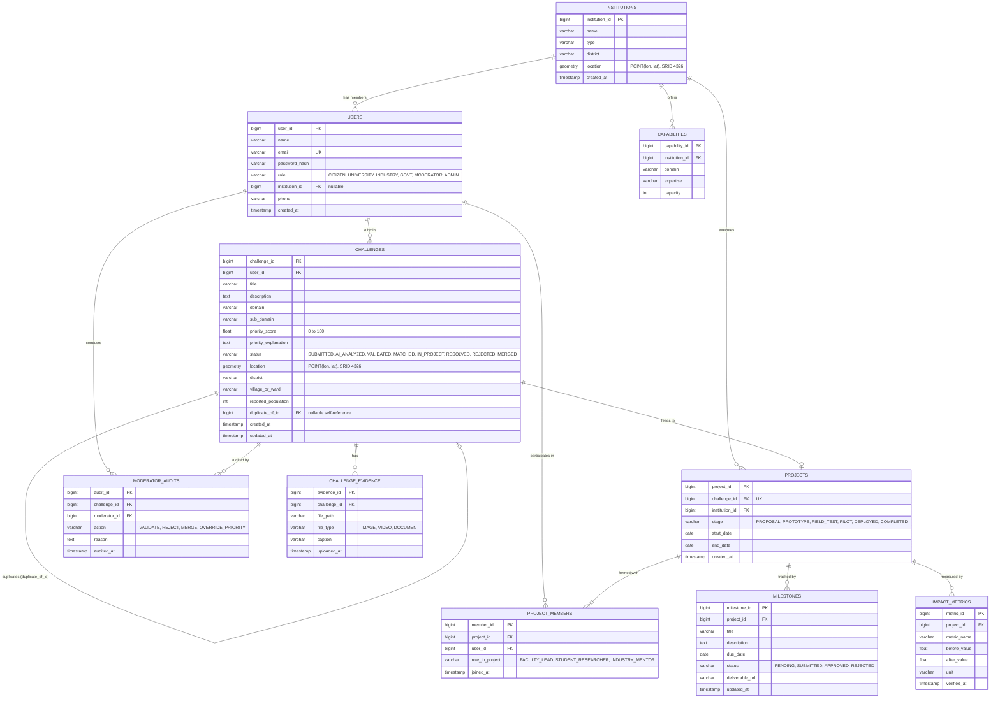

# CivicSolve — Database Requirements & Schema Specification (`dbrequirement.md`)

This document details the database architecture, geospatial PostGIS configuration, Entity-Relationship (ER) diagram, and complete SQL DDL schema for **CivicSolve**.

---

## 1. Database Architecture & Technology Overview

- **RDBMS Engine**: PostgreSQL 16
- **Spatial Engine**: **PostGIS 3.4** extension for high-performance geospatial indexing and distance queries.
- **Coordinate Reference System**: WGS 84 (`SRID 4326`) for standard GPS latitude/longitude coordinates.
- **ORM / Persistence**: Spring Data JPA & Hibernate Spatial in Spring Boot 3.

---

## 2. Entity-Relationship (ER) Diagram

The following Mermaid diagram faithfully represents and expands the database structure shown in **Figure 2** of the project synopsis:



---

## 3. Spatial Strategy & PostGIS Indexing

Geographic queries are fundamental to CivicSolve's duplicate detection and university proximity calculations:
- Spatial column definition: `geometry(Point, 4326)`
- Spatial indexes using **GiST (Generalized Search Tree)**:
  ```sql
  CREATE INDEX idx_challenges_location ON challenges USING GIST (location);
  CREATE INDEX idx_institutions_location ON institutions USING GIST (location);
  ```
- **Proximity Search Query Example**:
  Find all challenges within 15 kilometers of a given latitude and longitude:
  ```sql
  SELECT challenge_id, title, ST_Distance(location::geography, ST_SetSRID(ST_Point(75.8321, 22.9734), 4326)::geography) / 1000 AS distance_km
  FROM challenges
  WHERE ST_DWithin(location::geography, ST_SetSRID(ST_Point(75.8321, 22.9734), 4326)::geography, 15000)
  ORDER BY distance_km ASC;
  ```

---

## 4. Complete SQL DDL Schema (PostgreSQL + PostGIS)

```sql
-- 1. Enable PostGIS extension
CREATE EXTENSION IF NOT EXISTS postgis;

-- 2. Institutions Table
CREATE TABLE institutions (
    institution_id BIGSERIAL PRIMARY KEY,
    name VARCHAR(255) NOT NULL,
    type VARCHAR(50) NOT NULL, -- 'UNIVERSITY', 'COLLEGE', 'INDUSTRY', 'RESEARCH_LAB'
    district VARCHAR(100) NOT NULL,
    location GEOMETRY(Point, 4326) NOT NULL,
    created_at TIMESTAMP WITH TIME ZONE DEFAULT CURRENT_TIMESTAMP
);
CREATE INDEX idx_institutions_location ON institutions USING GIST (location);
CREATE INDEX idx_institutions_district ON institutions (district);

-- 3. Capabilities Table
CREATE TABLE capabilities (
    capability_id BIGSERIAL PRIMARY KEY,
    institution_id BIGINT NOT NULL REFERENCES institutions(institution_id) ON DELETE CASCADE,
    domain VARCHAR(100) NOT NULL,
    expertise VARCHAR(255) NOT NULL,
    capacity INT DEFAULT 5 CHECK (capacity >= 0)
);
CREATE INDEX idx_capabilities_domain ON capabilities (domain);

-- 4. Users Table
CREATE TABLE users (
    user_id BIGSERIAL PRIMARY KEY,
    name VARCHAR(150) NOT NULL,
    email VARCHAR(150) UNIQUE NOT NULL,
    password_hash VARCHAR(255) NOT NULL,
    role VARCHAR(50) NOT NULL CHECK (role IN ('CITIZEN', 'UNIVERSITY', 'INDUSTRY', 'GOVT', 'MODERATOR', 'ADMIN')),
    institution_id BIGINT REFERENCES institutions(institution_id) ON DELETE SET NULL,
    phone VARCHAR(20),
    created_at TIMESTAMP WITH TIME ZONE DEFAULT CURRENT_TIMESTAMP
);
CREATE INDEX idx_users_role ON users (role);

-- 5. Challenges Table
CREATE TABLE challenges (
    challenge_id BIGSERIAL PRIMARY KEY,
    user_id BIGINT NOT NULL REFERENCES users(user_id) ON DELETE RESTRICT,
    title VARCHAR(255) NOT NULL,
    description TEXT NOT NULL,
    domain VARCHAR(100),
    sub_domain VARCHAR(100),
    priority_score FLOAT CHECK (priority_score >= 0.0 AND priority_score <= 100.0),
    priority_explanation TEXT,
    status VARCHAR(50) NOT NULL DEFAULT 'SUBMITTED' 
        CHECK (status IN ('SUBMITTED', 'AI_ANALYZED', 'VALIDATED', 'MATCHED', 'IN_PROJECT', 'RESOLVED', 'REJECTED', 'MERGED')),
    location GEOMETRY(Point, 4326) NOT NULL,
    district VARCHAR(100) NOT NULL,
    village_or_ward VARCHAR(150),
    reported_population INT DEFAULT 0,
    duplicate_of_id BIGINT REFERENCES challenges(challenge_id) ON DELETE SET NULL,
    created_at TIMESTAMP WITH TIME ZONE DEFAULT CURRENT_TIMESTAMP,
    updated_at TIMESTAMP WITH TIME ZONE DEFAULT CURRENT_TIMESTAMP
);
CREATE INDEX idx_challenges_location ON challenges USING GIST (location);
CREATE INDEX idx_challenges_status ON challenges (status);
CREATE INDEX idx_challenges_domain ON challenges (domain);
CREATE INDEX idx_challenges_district ON challenges (district);
CREATE INDEX idx_challenges_priority ON challenges (priority_score DESC);

-- 6. Challenge Evidence Table
CREATE TABLE challenge_evidence (
    evidence_id BIGSERIAL PRIMARY KEY,
    challenge_id BIGINT NOT NULL REFERENCES challenges(challenge_id) ON DELETE CASCADE,
    file_path VARCHAR(500) NOT NULL,
    file_type VARCHAR(50) NOT NULL CHECK (file_type IN ('IMAGE', 'VIDEO', 'DOCUMENT')),
    caption VARCHAR(255),
    uploaded_at TIMESTAMP WITH TIME ZONE DEFAULT CURRENT_TIMESTAMP
);
CREATE INDEX idx_evidence_challenge ON challenge_evidence (challenge_id);

-- 7. Moderator Audits Table
CREATE TABLE moderator_audits (
    audit_id BIGSERIAL PRIMARY KEY,
    challenge_id BIGINT NOT NULL REFERENCES challenges(challenge_id) ON DELETE CASCADE,
    moderator_id BIGINT NOT NULL REFERENCES users(user_id) ON DELETE RESTRICT,
    action VARCHAR(50) NOT NULL CHECK (action IN ('VALIDATE', 'REJECT', 'MERGE', 'OVERRIDE_PRIORITY')),
    reason TEXT NOT NULL,
    audited_at TIMESTAMP WITH TIME ZONE DEFAULT CURRENT_TIMESTAMP
);
CREATE INDEX idx_audits_challenge ON moderator_audits (challenge_id);

-- 8. Projects Table
CREATE TABLE projects (
    project_id BIGSERIAL PRIMARY KEY,
    challenge_id BIGINT UNIQUE NOT NULL REFERENCES challenges(challenge_id) ON DELETE RESTRICT,
    institution_id BIGINT NOT NULL REFERENCES institutions(institution_id) ON DELETE RESTRICT,
    stage VARCHAR(50) NOT NULL DEFAULT 'PROPOSAL' 
        CHECK (stage IN ('PROPOSAL', 'PROTOTYPE', 'FIELD_TEST', 'PILOT', 'DEPLOYED', 'COMPLETED')),
    start_date DATE NOT NULL DEFAULT CURRENT_DATE,
    end_date DATE,
    created_at TIMESTAMP WITH TIME ZONE DEFAULT CURRENT_TIMESTAMP
);
CREATE INDEX idx_projects_stage ON projects (stage);

-- 9. Project Members Table
CREATE TABLE project_members (
    member_id BIGSERIAL PRIMARY KEY,
    project_id BIGINT NOT NULL REFERENCES projects(project_id) ON DELETE CASCADE,
    user_id BIGINT NOT NULL REFERENCES users(user_id) ON DELETE RESTRICT,
    role_in_project VARCHAR(50) NOT NULL CHECK (role_in_project IN ('FACULTY_LEAD', 'STUDENT_RESEARCHER', 'INDUSTRY_MENTOR')),
    joined_at TIMESTAMP WITH TIME ZONE DEFAULT CURRENT_TIMESTAMP,
    UNIQUE (project_id, user_id)
);

-- 10. Milestones Table
CREATE TABLE milestones (
    milestone_id BIGSERIAL PRIMARY KEY,
    project_id BIGINT NOT NULL REFERENCES projects(project_id) ON DELETE CASCADE,
    title VARCHAR(200) NOT NULL,
    description TEXT,
    due_date DATE NOT NULL,
    status VARCHAR(50) NOT NULL DEFAULT 'PENDING' CHECK (status IN ('PENDING', 'SUBMITTED', 'APPROVED', 'REJECTED')),
    deliverable_url VARCHAR(500),
    updated_at TIMESTAMP WITH TIME ZONE DEFAULT CURRENT_TIMESTAMP
);
CREATE INDEX idx_milestones_project ON milestones (project_id);

-- 11. Impact Metrics Table
CREATE TABLE impact_metrics (
    metric_id BIGSERIAL PRIMARY KEY,
    project_id BIGINT NOT NULL REFERENCES projects(project_id) ON DELETE CASCADE,
    metric_name VARCHAR(150) NOT NULL,
    before_value FLOAT NOT NULL,
    after_value FLOAT NOT NULL,
    unit VARCHAR(50) NOT NULL,
    verified_at TIMESTAMP WITH TIME ZONE DEFAULT CURRENT_TIMESTAMP
);
CREATE INDEX idx_impact_project ON impact_metrics (project_id);
```

---

## 5. Seed Data for Immediate Testing

```sql
-- Insert Institutions
INSERT INTO institutions (institution_id, name, type, district, location) VALUES
(1, 'Acropolis Institute of Technology & Research (AITR)', 'UNIVERSITY', 'Indore', ST_SetSRID(ST_Point(75.8956, 22.8214), 4326)),
(2, 'Shri Govindram Seksaria Institute of Technology and Science (SGSITS)', 'UNIVERSITY', 'Indore', ST_SetSRID(ST_Point(75.8754, 22.7244), 4326)),
(3, 'Indian Institute of Technology Indore (IIT Indore)', 'RESEARCH_LAB', 'Indore', ST_SetSRID(ST_Point(75.9207, 22.5204), 4326)),
(4, 'AquaFilter Pvt. Ltd.', 'INDUSTRY', 'Indore', ST_SetSRID(ST_Point(75.8577, 22.7196), 4326));

-- Insert Capabilities
INSERT INTO capabilities (institution_id, domain, expertise, capacity) VALUES
(1, 'Water Supply', 'IoT telemetry, groundwater turbidity monitoring', 4),
(1, 'Rural Infrastructure', 'Low-cost road stability analysis', 3),
(2, 'Water Supply', 'Environmental engineering, chemical water filtration', 5),
(2, 'Sanitation', 'Municipal solid waste management', 4),
(4, 'Water Supply', 'Commercial gravity-fed ceramic membrane filtration', 10);

-- Insert Users
INSERT INTO users (user_id, name, email, password_hash, role, institution_id, phone) VALUES
(1, 'Ramesh Patel', 'citizen@civicsolve.in', '$2a$12$e80yqRzK.9y4p2N0O14c2.Wj7E0eZ3pGzZ2X6L5nE9m4H1u9Q5R4a', 'CITIZEN', NULL, '9876543210'),
(2, 'Prof. Aaquib Multani', 'faculty@aitr.ac.in', '$2a$12$e80yqRzK.9y4p2N0O14c2.Wj7E0eZ3pGzZ2X6L5nE9m4H1u9Q5R4a', 'UNIVERSITY', 1, '9826012345'),
(3, 'District Collector Officer', 'collector.indore@mp.gov.in', '$2a$12$e80yqRzK.9y4p2N0O14c2.Wj7E0eZ3pGzZ2X6L5nE9m4H1u9Q5R4a', 'GOVT', NULL, '07312444555'),
(4, 'State Review Moderator', 'moderator@civicsolve.in', '$2a$12$e80yqRzK.9y4p2N0O14c2.Wj7E0eZ3pGzZ2X6L5nE9m4H1u9Q5R4a', 'MODERATOR', NULL, '9998887776');

-- Insert Sample Challenge
INSERT INTO challenges (challenge_id, user_id, title, description, domain, sub_domain, priority_score, priority_explanation, status, location, district, village_or_ward, reported_population) VALUES
(1042, 1, 'Persistent handpump turbidity and muddy water after monsoon', 'Our village community handpump dispenses yellowish mud water after rainfall. School children have developed gastrointestinal illness.', 'Water Supply', 'Groundwater Quality', 82.4, 'Severity 0.90, Population 1200, Health hazard flag active near primary school', 'VALIDATED', ST_SetSRID(ST_Point(75.8321, 22.9734), 4326), 'Indore', 'Sanwer Ward 4', 1200);

-- Insert Challenge Evidence
INSERT INTO challenge_evidence (challenge_id, file_path, file_type, caption) VALUES
(1042, '/uploads/evidence/1042_handpump_muddy.jpg', 'IMAGE', 'Turbid water collected in bucket at 10 AM');

-- Insert Solution Project
INSERT INTO projects (project_id, challenge_id, institution_id, stage, start_date) VALUES
(501, 1042, 1, 'PROTOTYPE', '2026-10-01');

-- Insert Project Milestone
INSERT INTO milestones (project_id, title, description, due_date, status) VALUES
(501, 'Water Sample Lab Analysis', 'Complete chemical, fluoride, and microbiological testing of water samples', '2026-10-15', 'APPROVED'),
(501, 'Sand-Gravel Pre-filter Prototype', 'Design low-cost casing pre-filter to fit village handpump outlet', '2026-11-05', 'PENDING');

-- Insert Impact Metric
INSERT INTO impact_metrics (project_id, metric_name, before_value, after_value, unit) VALUES
(501, 'Water Turbidity Level', 85.0, 4.2, 'NTU'),
(501, 'Beneficiaries Served', 0.0, 1200.0, 'Citizens');
```
