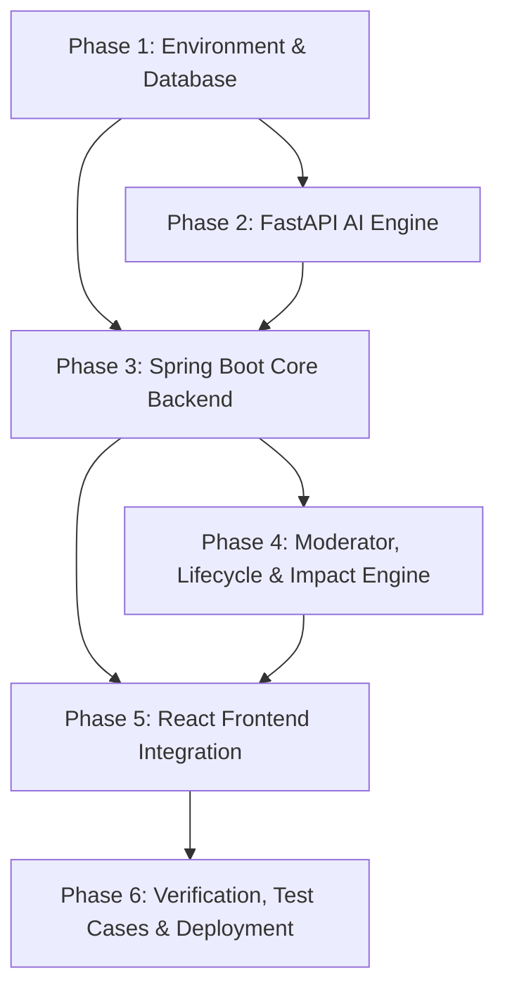

# CivicSolve — Phased Implementation Roadmap (`implementation.md`)

This document outlines the step-by-step engineering plan for CivicSolve across **six progressive phases**, corresponding to the 16-week academic engineering schedule specified in the project synopsis.

---

## Phase Overview & Dependency Graph



---

## Phase 1: Environment Setup & Database Foundation (Weeks 4–7)

### 1.1 Objectives
- Initialize the unified monorepo or multi-service repository structure.
- Configure PostgreSQL 16 with the **PostGIS** extension for geospatial storage and spatial indexing.
- Establish database migration scripts (Flyway or raw SQL DDL) and Docker Compose definitions for local reproducibility.

### 1.2 Module Deliverables
1. **Docker Compose Configuration (`docker-compose.yml`)**:
   - `postgres-postgis`: Image `postgis/postgis:16-3.4`, port 5432, persistent volume for GIS data.
   - `spring-boot-api`: Spring Boot 3 Java 17 application service container.
   - `fastapi-ai`: Python 3.11 container with sentence-transformers & scikit-learn.
   - `frontend`: Vite React single page application.
2. **Database Initialization DDL Scripts (`db/migration/V1__init.sql`)**:
   - PostGIS extension activation: `CREATE EXTENSION IF NOT EXISTS postgis;`
   - Core tables: `users`, `institutions`, `capabilities`, `challenges`, `challenge_evidence`, `projects`, `milestones`, `impact_metrics`, and `moderator_audits`.
   - Spatial indexing on `challenges.location` and `institutions.location` using `USING GIST`.
3. **Seed Data Scripts (`db/seed/`)**:
   - 25+ realistic sample challenges across Madhya Pradesh districts (Indore, Dhar, Sehore, Dewas, Barwani).
   - Profiles of participating Higher Education Institutions (AITR Indore, SGSITS Indore, IIT Indore, RGPV Bhopal, MANIT Bhopal) with departmental capability matrices.

### 1.3 Exit Criteria
- `docker compose up -d` spins up PostgreSQL with PostGIS active.
- Schema verification queries succeed with spatial function tests (e.g., `ST_Distance(location, ...) < 50000`).

---

## Phase 2: Python / FastAPI AI Microservice (Weeks 8–12)

### 2.1 Objectives
- Construct the standalone FastAPI microservice providing intelligent NLP, semantic duplicate clustering, explainable priority calculation, and capability-based HEI matching over REST JSON APIs.

### 2.2 Module Deliverables
1. **FastAPI Application Structure (`ai-service/`)**:
   ```
   ai-service/
   ├── app/
   │   ├── api/
   │   │   ├── classify.py     # Domain classification & keyword extraction
   │   │   ├── duplicate.py    # Semantic embeddings & similarity check
   │   │   ├── priority.py     # Explainable scoring engine
   │   │   └── matching.py     # Capability & proximity matching
   │   ├── core/
   │   │   ├── config.py       # Model paths, thresholds
   │   │   └── nlp.py          # SentenceTransformer model wrapper
   │   ├── models/             # Pre-trained or fine-tuned scikit-learn models
   │   └── main.py             # FastAPI entrypoint
   ├── requirements.txt
   └── Dockerfile
   ```
2. **AI Pipelines**:
   - **Pipeline A: Domain Classifier & Sub-domain Classifier**:
     - Model: `sentence-transformers/all-MiniLM-L6-v2` generating 384-dimensional dense vectors + `scikit-learn` Logistic Regression / LinearSVC classifier trained on labelled sample dataset of 200–300 societal problems.
     - Output: Primary domain (e.g., `Water Supply`), sub-domain (`Groundwater Quality`), and confidence score (`0.00 – 1.00`).
   - **Pipeline B: Semantic Duplicate Detection & Clustering**:
     - Cosine similarity comparison between incoming embedding and existing active challenges within a 15 km spatial radius.
     - Threshold: If `similarity >= 0.75`, flag as potential duplicate with matching challenge IDs and similarity scores.
   - **Pipeline C: Explainable Priority Scoring Engine (0–100)**:
     - Mathematical Model:
       $$\text{Priority} = w_1 \cdot \text{Severity} + w_2 \cdot \text{AffectedPop} + w_3 \cdot \text{Recurrence} + w_4 \cdot \text{HealthRisk}$$
     - Formula breakdown returned as an explainable textual rationale string (e.g., `"High priority due to repeat waterborne hazard near public school"`).
   - **Pipeline D: Capability-Based Institution Matching**:
     - Vector cosine matching between problem keywords/taxonomy and university department capability tags, multiplied by an inverse-distance decay factor based on PostGIS GPS coordinates.

### 2.3 Exit Criteria
- FastAPI Swagger UI (`/docs`) available on port 8000.
- Unit tests verifying classification, duplicate detection, and matching with test payloads.

---

## Phase 3: Spring Boot 3 Core Backend & Security (Weeks 8–12)

### 3.1 Objectives
- Develop the Java 17 Spring Boot 3 modular monolith orchestrating core domain logic, security, challenge submission, and asynchronous AI gateway communication.

### 3.2 Module Deliverables
1. **Modular Architecture Package Structure (`backend/`)**:
   ```
   src/main/java/org/civicsolve/
   ├── auth/                # Spring Security 6, JWT Filter, UserDetailsService
   ├── user/                # User entity, roles (CITIZEN, UNIVERSITY, INDUSTRY, GOVT, ADMIN)
   ├── challenge/           # Challenge entity, intake controller, spatial repository
   ├── ai/                  # AI Gateway REST client (WebClient / RestClient)
   ├── moderation/          # Validation workflow, status transitions, audit logging
   ├── institution/         # Institution profiles, capabilities, faculty directories
   ├── project/             # Solution projects, teams, milestones, stage-gates
   ├── impact/              # Impact Ledger metrics, before/after comparisons
   └── analytics/           # District aggregates, domain distributions, heatmaps
   ```
2. **Security & RBAC**:
   - Stateless JWT authentication filter.
   - Secure BCrypt password hashing.
   - Fine-grained `@PreAuthorize("hasRole('MODERATOR')")` and endpoint security configurations.
3. **Asynchronous AI Gateway Client**:
   - Async event listener (`@Async` or Spring ApplicationEventPublisher) triggers FastAPI analysis upon challenge submission without blocking the citizen's response.
   - Automatic database update upon AI service response (`status = AI_ANALYZED`).
4. **Geospatial Query Implementations**:
   - `ChallengeRepository` queries utilizing Hibernate Spatial / PostGIS:
     - `findWithinRadius(Point p, double distanceInMeters)`
     - `findAggregatesByDistrict()`

### 3.3 Exit Criteria
- REST API integration passing Postman collection tests for challenge submission, login, and retrieval.
- Asynchronous AI gateway successfully requests FastAPI and populates the Challenge Card.

---

## Phase 4: Moderator Workflow, Project Lifecycle & Impact Engine (Weeks 11–13)

### 4.1 Objectives
- Implement the collaborative human-in-the-loop review workflow, university team assignment, milestone tracking, and impact recording.

### 4.2 Module Deliverables
1. **Moderation Module**:
   - Workflow state machine:
     `SUBMITTED` $\to$ `AI_ANALYZED` $\to$ `VALIDATED` (or `REJECTED` / `MERGED`).
   - Merge operation: Attaches child duplicate reports to parent challenge and aggregates total affected citizen counts.
   - Audit trail logger: Every moderation decision writes to `moderator_audits` with `moderator_id`, `timestamp`, `action`, and `reason`.
2. **Project Lifecycle Engine**:
   - Status transition upon HEI acceptance: `VALIDATED` $\to$ `MATCHED_TO_HEI` $\to$ `PROJECT_CREATED`.
   - Multi-disciplinary team builder: Faculty mentor assigner, student member role allocations.
   - Stage-Gate progression engine:
     `PROPOSAL` $\to$ `PROTOTYPE` $\to$ `FIELD_TEST` $\to$ `PILOT` $\to$ `DEPLOYED`.
   - Milestone checklist validator: Requires document proof upload before stage promotion.
3. **Impact Ledger Module**:
   - Immutable before-and-after metric recorder (e.g., Water Contamination Index, Commute Disruption Hours).
   - Citizen validation survey trigger upon project completion.

### 4.3 Exit Criteria
- Complete lifecycle can be stepped through from moderation review down to completed project impact recording via authenticated API calls.

---

## Phase 5: React Frontend Integration & Polish (Weeks 11–13)

### 5.1 Objectives
- Expand the existing `dummy frontend` into the fully connected CivicSolve Single Page Application with all interactive role dashboards.

### 5.2 Module Deliverables
1. **Integration with Backend APIs**:
   - Configure TanStack Query / Axios client with JWT bearer token interceptors.
   - Connect dynamic counters on landing page to live `/api/analytics/summary` endpoint.
2. **Key Pages & Views**:
   - **Submit Challenge View (`/submit`)**:
     - Leaflet GPS map with draggable marker and search bar.
     - Geotagged multi-image upload dropzone with previews.
     - Real-time AI preview chips (domain, keywords).
   - **Challenge Details Page (`/challenges/:id`)**:
     - Wireframe layout matching Figure 5 from synopsis.
     - Interactive AI Analysis Card with explainable priority gauge, duplicate cluster list, and ranked universities with direct `Accept` triggers.
   - **Role Dashboards**:
     - Citizen Dashboard (`/dashboard/citizen`): My reports, timeline, feedback surveys.
     - Moderator Console (`/dashboard/moderator`): Pending queue, side-by-side duplicate merge UI.
     - University Workspace (`/dashboard/university`): Matched challenges, team formation, milestone manager.
     - Industry Dashboard (`/dashboard/industry`): Mentorship requests, CSR sponsorship.
     - Government Heatmap View (`/dashboard/government`): Leaflet choropleth district heatmap.
3. **Bilingual Accessibility Enhancements**:
   - Complete dictionary translations for English (`en`) and Hindi (`hi`).
   - Font scaling toggles (`A-`, `A`, `A+`) bound to CSS variables.

### 5.3 Exit Criteria
- Seamless end-to-end user experience in browser: a user can report a problem, inspect the AI card, validate it as moderator, accept it as university, update milestones, and view it on the public impact ledger.

---

## Phase 6: System Integration, End-to-End Validation & Deployment (Weeks 14–16)

### 6.1 Objectives
- Execute all 10 representative test cases from Table 5 in the project synopsis.
- Package the system for one-click deployment via Docker Compose.
- Prepare project documentation and final presentation demos.

### 6.2 Test Matrix Execution (Table 5 Compliance)
| Test ID | Scenario | Input | Expected Output | Verification Method |
| :--- | :--- | :--- | :--- | :--- |
| **TC01** | Valid login | Correct email and password | JWT token returned; redirect to role dashboard | JUnit + Cypress/Vitest |
| **TC02** | Invalid login | Wrong password | 401 Unauthorized; error message displayed | JUnit + REST test |
| **TC03** | Challenge submission | Title, description, photo, GPS | Challenge created with status `SUBMITTED` | API test + DB check |
| **TC04** | AI classification | *"Handpump broken in school, no drinking water"* | Classified into `Water Supply` with confidence score | FastAPI pytest |
| **TC05** | Duplicate detection | New report similar to existing | Suggested duplicate returned with similarity score | Cosine similarity test |
| **TC06** | Priority score range | Challenge with urgency, severity, pop. | Score in range `[0, 100]` with textual rationale | Mathematical bound check |
| **TC07** | University recommendation| Validated challenge | Ranked HEIs shown with match scores & reasons | Algorithmic ranking test |
| **TC08** | Workflow transition | Moderator validates challenge | Status $\to$ `VALIDATED`; audit log recorded | State machine audit check |
| **TC09** | Unauthorized access | Student requests admin endpoint | HTTP 403 Forbidden response returned | Security filter check |
| **TC10** | Dashboard load | Government dashboard with 1000 items | Aggregates load within acceptable latency (<500ms) | Load benchmark test |

### 6.3 Final Exit Criteria
- All 10 test cases verified and passing green.
- Single command `docker compose up --build` launches the complete ecosystem.
