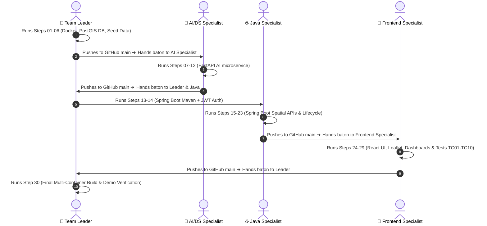

# CivicSolve — Team Collaboration & Role Alignment Guide (`team_instructions.md`)

Welcome to the **CivicSolve** development team! This guide aligns our 4 team members with their exact technical domains so that **everyone works purely in their area of expertise with zero merge conflicts**.

---

## 👥 Real Team Roles & Prompt Allocations (30 Total Prompts)

Our team consists of 4 distinct technical profiles:
1. **👑 Team Leader**: Full-Stack Architecture, Environment, Docker, Database, and Security baseline.
2. **🤖 AI / Data Science Specialist**: Python, FastAPI, SentenceTransformers, NLP classification, Deduplication, and Matching.
3. **☕ Java Backend Specialist**: Java 17, Spring Boot 3, Hibernate Spatial, PostGIS queries, and Lifecycle APIs.
4. **🎨 Frontend Specialist**: React 19, TypeScript, Tailwind CSS, Leaflet Maps, and Multi-Role Dashboards.

### Role-Based Prompt Distribution Table

| Team Member & Role | Assigned Steps in [prompts.md](file:///c:/Users/hp/Desktop/College%20stuff/MINOR/Minorpro/prompts.md) | Focus Technology | Key Deliverables |
| :--- | :---: | :--- | :--- |
| **👑 Team Leader**<br>*(Full-Stack & DevOps Lead)* | **Steps 01 – 06** *(Phase 1)*<br>+ **Steps 13 – 14** *(Phase 3 Auth)*<br>+ **Step 30** *(Phase 6 Launch)*<br>👉 **9 Prompts Total** | Docker, PostGIS, Maven, Spring Security JWT | • Workspace scaffolding & Gitignore<br>• `.env` configuration & Docker Compose<br>• PostgreSQL + PostGIS Schema & Seed data<br>• Spring Boot Maven setup & JWT RBAC<br>• Final Production Docker build & smoke test |
| **🤖 AI / Data Science Specialist**<br>*(Member 2)* | **Steps 07 – 12** *(Phase 2)*<br>👉 **6 Prompts Total** | Python 3.11, FastAPI, PyTorch, SentenceTransformers | • FastAPI AI app & Healthcheck (`ai-service/`)<br>• SentenceTransformer embeddings singleton<br>• Thematic domain & sub-domain classifier<br>• Semantic duplicate detection engine<br>• Explainable priority scoring formula (0–100)<br>• University capability & proximity matcher |
| **☕ Java Backend Specialist**<br>*(Member 3)* | **Steps 15 – 23** *(Phase 3 & Phase 4)*<br>👉 **9 Prompts Total** | Java 17, Spring Boot 3, Hibernate Spatial, PostGIS | • Spatial Challenge repository (`ST_DWithin`)<br>• Multipart challenge intake & photo storage<br>• Non-blocking async AI Gateway client<br>• Institution & capability REST endpoints<br>• Moderator review, duplicate merge & audit log<br>• University team builder & project claim<br>• Stage-gates & milestone proof checklists<br>• Public Impact Ledger & District analytics |
| **🎨 Frontend Specialist**<br>*(Member 4)* | **Steps 24 – 29** *(Phase 5 & Phase 6)*<br>👉 **6 Prompts Total** | React 19, Vite, TypeScript, Tailwind CSS, Leaflet | • Axios client with JWT bearer interceptors<br>• Interactive Leaflet GPS map picker component<br>• Multi-step challenge submission form with AI chips<br>• Challenge dossier & AI Card (Figure 5)<br>• Citizen, Moderator, University, Govt dashboards<br>• Automated test suite validation (TC01–TC10) |

---

## 🚀 The Seamless 5-Stage Relay Execution

To guarantee **zero merge conflicts**, the team executes in this exact relay sequence:



---

## 🛠️ Prerequisites by Role

| Team Member | What to Install on Laptop | Where You Will Work |
| :--- | :--- | :--- |
| **👑 Team Leader** | Docker Desktop, Git, VS Code | Root, `docker-compose.yml`, `db/`, `backend/` |
| **🤖 AI Specialist** | Python 3.11, Git, VS Code / PyCharm | Only inside **`ai-service/`** |
| **☕ Java Specialist** | JDK 17, Maven, Git, IntelliJ / VS Code | Only inside **`backend/`** |
| **🎨 Frontend Specialist** | Node.js 20+, Git, VS Code | Only inside **`dummy frontend/`** |

---

## 📖 Step-by-Step Instructions for Each Member

When your turn arrives:
1. **Pull the latest code**:
   ```bash
   git pull origin main
   ```
2. **Open [`prompts.md`](file:///c:/Users/hp/Desktop/College%20stuff/MINOR/Minorpro/prompts.md)** and navigate to your assigned steps:
   - Click the **Copy** button on the `📋 Copy & Paste This Prompt:` code box.
   - Paste it into your AI assistant (Antigravity IDE / Cursor / ChatGPT) to generate the code.
3. **Verify the Checklist**: Check the `✅ Done When` section and tick off `[x]`.
4. **Log your work in [`explain.md`](file:///c:/Users/hp/Desktop/College%20stuff/MINOR/Minorpro/explain.md)**:
   ```markdown
   ### [Iteration X] - Completed Step Y: Title (By Your Name)
   - Built module ...
   - Verified that ... works as expected.
   ```
5. **Commit and Push**:
   ```bash
   git add .
   git commit -m "feat: completed step Y"
   git push origin main
   ```
6. **Alert the next teammate** on WhatsApp / Discord that their turn has started!

---

## 🎯 Final Outcome
With this clean role division, **everyone writes code only in their favorite stack**, nobody gets confused, and the entire Minor Project will be 100% finished and working! 🚀
